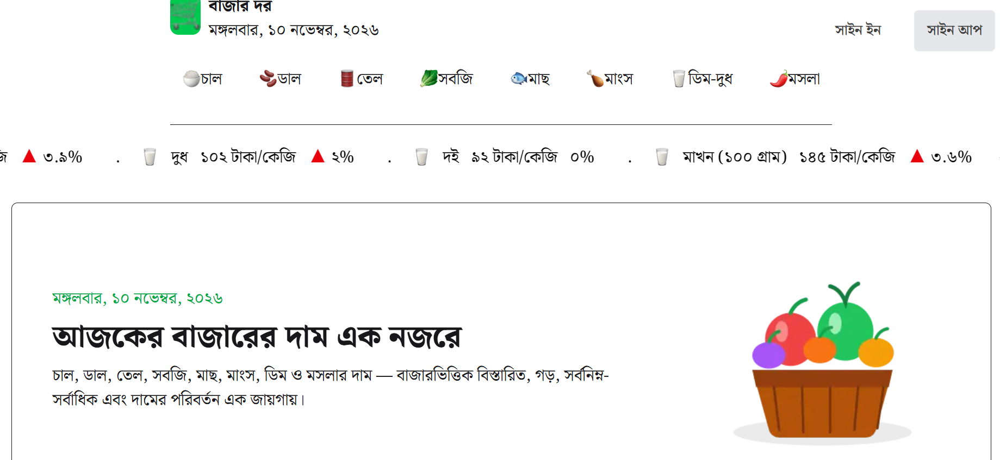

🛒 বাজার দর (BazarDor)

About The Project

BazarDor is a website where users can check the prices of different daily necessities, such as vegetables, fish, and other market products. Users can see the price differences between products and get an idea of which products are cheaper or more expensive in the market.

Users can also create an account and sign in to the website.

Live Website

🔗 Live Link: https://b14-a-7-bazar-q0czc9zm8-a-06.vercel.app/

## Screenshot

Technologies Used

- HTML
- CSS
- JavaScript
- React
- Next.js
- TypeScript
- Tailwind CSS
- better-auth

Key Features

1. Product Price Checking
   Users can check the prices of different products, including vegetables, fish, and other daily market items.

2. Price Comparison
   Users can compare product prices to understand which products are cheaper or more expensive.

3. User Sign Up
   New users can create an account to access the website.

4. User Sign In
   Registered users can sign in to their accounts.

5. Easy-to-Use Interface
   The website provides a simple interface so users can easily find product prices and get useful market information.

Dependencies

The main dependencies used in this project include:

- next
- react
- react-dom
- better-auth
- mongodb
- react-toastify
- lucide-react

Installation and Setup

Follow these steps to run the project locally.

1. Clone the repository

git clone https://github.com/nishattasnimtonni5-lang/b14-A-7-Bazar-Dor

2. Navigate to the project directory

cd bazardor

3. Install dependencies

npm install

4. Run the development server

npm run dev

5. Open your browser

Visit http://localhost:3000 to view the website.

Relevant Links

- Live Website: https://b14-a-7-bazar-q0czc9zm8-a-06.vercel.app/
- GitHub Repository: https://github.com/nishattasnimtonni5-lang/b14-A-7-Bazar-Dor